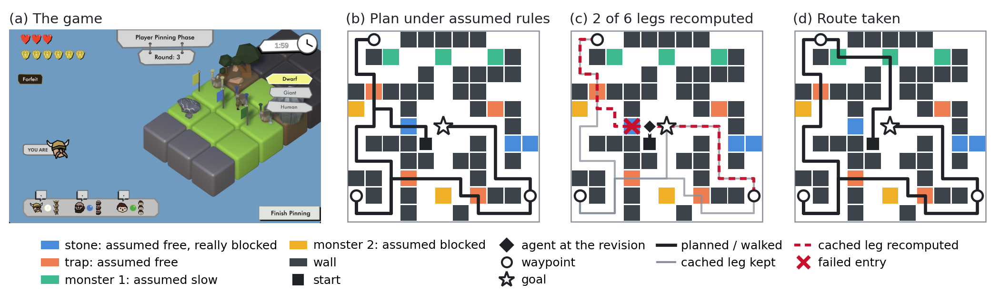

<div align="center">

# Recomputing Only What Depended on It

### Rule-Support Indexing for Exact Plan Repair Under Model Revision

*Under review at the Trust4RSI-Agent workshop, AAAI 2027*

[](paper/main.pdf)
[](https://github.com/sarvesh-tiku/Rule-Support-Indexing-Trust4RSI-Agent/actions/workflows/tests.yml)
[](requirements.txt)
[](LICENSE)

[**Paper**](paper/main.pdf) · [**Analysis plan**](PREREG.md) · [**Audit**](docs/AUDIT.md) · [**Raw results**](results/) · [**Reproduce**](#reproducing-the-paper)



<sub>An entry into a stone cell fails, the stone rule is committed as costlier, and only the 2 of 6 cached legs that list it are recomputed.</sub>

</div>

---

## Abstract

> An agent plans a route around an obstacle it believes is costly to cross, then learns the
> obstacle is cheap. The route never touched the obstacle, yet it may no longer be the best one.
> Agents that revise their world model usually rebuild the whole plan after any revision. We ask
> what a planner must record to recompute only what depended on the revised belief, and still be
> exact. Each cached subplan records the rules its route uses (*direct support*) and the rules it
> avoids that could make another route better if they became cheaper (*alternative support*). We
> prove that, when every obstacle costs at least a fixed margin more than an open cell,
> recomputing only the subplans that list a revised rule gives a plan of the same cost under the
> agent's current model as rebuilding everything.

## The idea in one minute

A cached leg (a shortest path between two waypoints) can go stale in two ways when a rule is revised:

1. a rule **on its path** changed, so its cost changed;
2. its path is untouched, but a rule it **avoided** became cheaper and another path now beats it.

Recording only the rules a path uses catches the first case and misses the second. So every leg
ℓ from *a* to *b* with cost *C*<sub>ℓ</sub> stores two sets:

| Set | Name | Contents | Invalidated when |
|---|---|---|---|
| `val(ℓ)` | direct support | types of the cells the leg enters | the rule gets costlier **or** cheaper |
| `blk(ℓ)` | alternative support | types *k* with a cell *x* such that *d*(*a*,*x*) + *d*(*x*,*b*) + ε < *C*<sub>ℓ</sub> | the rule gets cheaper |

*d* is Manhattan distance and ε is the least amount by which an obstacle costs more than an open
cell. The test is a lower bound on any path through *x*: if even the bound cannot beat the leg,
no price for rule *k* can, and *k* need not be watched.

**Proposition 1.** If an open cell costs 1 and an obstacle cell at least 1 + ε under every
committed model, recomputing only the invalidated legs and re-solving the waypoint ordering gives
a plan whose cost equals that of a plan computed from scratch.

## Results

All numbers are produced by the commands below and stored in `results/`. † marks analyses added
after the pre-specified ones.

| Question | Result | File |
|---|---|---|
| Is indexed repair exact? | 0 mismatches against from-scratch plans in **17,170** repairs; same actions as full replanning in all 2,081 violation episodes | `final_diag.json`, `final_summary.json` |
| Does the proof survive brute force?† | 0 counterexamples in 15.7 million exhaustive 3×3 revisions and 10 million leg checks on random 4×4 and 5×5 boards | `counterexample_search.json`, `small_grid_bruteforce.json` |
| How much search does it save? | **0.56 / 0.66 / 0.67** of the node expansions of full replanning at 15×15 / 31×31 / 51×51 | `final_summary.json` |
| And time?† | 0.65 / 0.70 / 0.69 of a replanner that builds no index | `timing.json` |
| Is direct support alone enough?† | No: a non-optimal plan after **2.5% / 11.5% / 20.2%** of repairs | `valonly.json` |
| Against incremental search (LPA*)?† | LPA* saves more search (0.15 / 0.27 / 0.30 of A* on every leg; index 0.31 / 0.47 / 0.48). The index removes a further 11–18% on top of it | `incremental.json` |
| LPA* in wall-clock time?† | Optimised LPA* took 0.41 / 0.61 / 0.67 of the A* time, the index with A* 0.32 / 0.49 / 0.50. Counting the initial build, the index with A* was fastest (0.69–0.71; LPA* 1.17–1.35). State kept between commits: 2–6 KiB against 89–968 KiB | `incremental_audit.json` |
| When does the index pay?† | When under about half the cached legs change; about 4% overhead when nearly all do. 61% of commits changed none | `coverage_sweep.json` |
| Can revision make the agent unreliable?† | Yes: revising agents abandoned a reachable goal in 19 of 1,800 episodes on game-derived layouts and 42 of 5,275 on new maps, by treating a 95% belief as certain | `abandonment.json`, `safeguard_validation.json` |
| Does staging such commits help?† | 0 abandonments in both sets (95% upper bound 0.17%); recognising a truly unreachable goal takes about twice as many actions (97 against 46) | `safeguard_validation.json`, `safeguard_audit.json` |

> **What this is not.** The guarantee is equal plan cost under the agent's committed model. It is
> not rollback (no earlier model is restored), not a claim about general hierarchical planning,
> and not a claim that plans which are optimal under the model lead to reliable behaviour.
> See [Scope and known limits](#scope-and-known-limits).

## Quick start

Python 3.10+ with numpy, scipy and matplotlib.

```
pip install -r requirements.txt
make test          # 15 tests, about a minute
make smoke         # a small end-to-end run of the main experiment and analysis
```

## Reproducing the paper

Everything is deterministic given the seeds, except wall-clock timings. Each results file
records a SHA-256 of `cpr/*.py`; the reported runs used `0560a1c8…`.

| Step | Command | Output |
|---|---|---|
| Main experiment (300 held-out maps × 3 sizes, about 9 min on 8 cores) | `python3 -m cpr.experiment --sizes 15 31 51 --seeds 1000 1300 --out results/final.jsonl` | `results/final.jsonl` |
| Pre-registered analysis | `python3 -m cpr.analyze results/final.jsonl --out results/final` | `final_summary.json`, `final_report.md` |
| Index against ground truth | `python3 -m cpr.diagnose --sizes 15 31 51 --seeds 1000 1300 --out results/final_diag.json` | `final_diag.json` |
| ε audit and exhaustive counterexample search | `python3 scripts/counterexample_search.py` | `counterexample_search.json` |
| Direct-support-only baseline | `python3 scripts/valonly_baseline.py` | `valonly.json` |
| Incremental search (LPA*), with and without the index | `python3 scripts/incremental_baseline.py` | `incremental.json` |
| Four-way benchmark with optimised LPA* (time, expansions, state) | `python3 scripts/incremental_audit.py --sizes 15 31 51 --seeds 1000 1300 --out results/incremental_audit.json` | `incremental_audit.json` |
| Repair cost against the fraction of legs that changed | `python3 scripts/coverage_sweep.py --sizes 15 31 51 --seeds 1000 1300 --out results/coverage_sweep.json` | `coverage_sweep.json` |
| Brute-force check of Proposition 1 on 4×4 and 5×5 boards | `python3 scripts/small_grid_bruteforce.py --layouts 20000 --out results/small_grid_bruteforce.json` | `small_grid_bruteforce.json` |
| Wall-clock time by phase | `python3 scripts/timing.py` | `timing.json` |
| Index size and peak memory | `python3 scripts/memory.py` | `memory.json` |
| Game-derived layouts | `python3 scripts/game_levels.py` | `game_levels.json` |
| Abandoned goals: traces and safeguard | `python3 scripts/abandonment_traces.py`; `python3 scripts/abandonment.py` | `abandonment_traces.json`, `abandonment.json` |
| Safeguard on fresh maps | `python3 scripts/safeguard_validation.py` | `safeguard_validation.json` |
| Safeguard intervals and threshold sweep on a third map set | `python3 scripts/safeguard_audit.py --seeds 30000 30600 --out results/safeguard_audit.json` | `safeguard_audit.json` |
| Map-level bootstrap | `python3 scripts/audit_stats.py results/final.jsonl results/audit_stats.json` | `audit_stats.json` |
| Tables and Figure 1 | `make tables figure` | `paper/table_primary.tex`, `paper/fig_game_walkthrough.pdf` |
| Paper | `make paper` | `paper/main.pdf` |

`make all-posthoc` runs the post-hoc scripts in turn, except the four audit scripts (`incremental_audit`, `coverage_sweep`, `small_grid_bruteforce`, `safeguard_audit`), which are run with the commands above.

## What was planned in advance and what was not

`PREREG.md` was written after a pilot on development maps (seeds 0–29) and before any run on
the final maps (seeds 1000–1299). It fixes the comparisons, the statistics and our predictions.

- **Pre-registered:** the main experiment and its analysis.
- **Disclosed deviation:** the first final run exposed a bug in the posterior-sampling baseline.
  It was fixed and the run repeated; every other agent's rows are identical. The first run is
  kept as `results/final_v1_psrl_bug.jsonl.gz`.
- **Post hoc** (marked † in the paper): everything under `scripts/`.
- **Safeguard:** designed on the 19 failures in `abandonment.json`, then run unchanged on new
  maps in `safeguard_validation.json`. Only the second is independent evidence.

## Layout

```
cpr/        simulator, planner with the support index, agents, experiment runner, analysis
tests/      unit tests and planner-level property tests
scripts/    post-hoc experiments, tables and figure
results/    raw rows (.jsonl), summaries and reports
paper/      LaTeX source, bibliography, generated tables and figure
docs/       AUDIT.md: proof audit, novelty comparison, and the reasoning behind each post-hoc run
PREREG.md   analysis plan frozen before the final run
```

Start with `cpr/planner.py` (`Leg` holds the two support sets and `affected` is the
invalidation test) and `cpr/agents.py` (`scoped_repair`).

## Scope and known limits

- Two-level routing on four-connected grids. Nothing here is shown for deeper task hierarchies.
- The alternative support uses a Manhattan-distance bound, which over-approximates: 15–34% of
  legs are invalidated where 10–19% really change.
- The exactness result needs every obstacle cell to cost at least 1 + ε under every committed
  model (ε = 1/0.9 − 1 here). `tests/test_index_properties.py` contains the counterexample
  that arises without it.
- The LPA* comparison covers the leg table only and one Python implementation of each method.
- Cell exceptions: walling off a cell is covered by the index; withdrawing exceptions triggers a full rebuild.
- `Agent.step` assumes the next waypoint is reachable when the episode starts; maps that
  violate this are filtered out by the scripts that can generate them.

## Citation

The paper is under double-blind review; please cite it as below until a final version exists.

```bibtex
@unpublished{rulesupport2026,
  title  = {Recomputing Only What Depended on It: Rule-Support Indexing for Exact Plan Repair Under Model Revision},
  author = {Anonymous},
  note   = {Under review, Trust4RSI-Agent workshop at AAAI 2027},
  year   = {2026}
}
```

## Third-party material

`scripts/game_levels.py` contains four level layouts transcribed from the game Dice Adventure,
and `paper/game_shot.png` is a screenshot of that game. They are included to make one experiment
and one figure reproducible and are not covered by this repository's licence. Check that you are
entitled to redistribute them before making the repository public.

## Licence

MIT for the code in this repository; see `LICENSE`.
